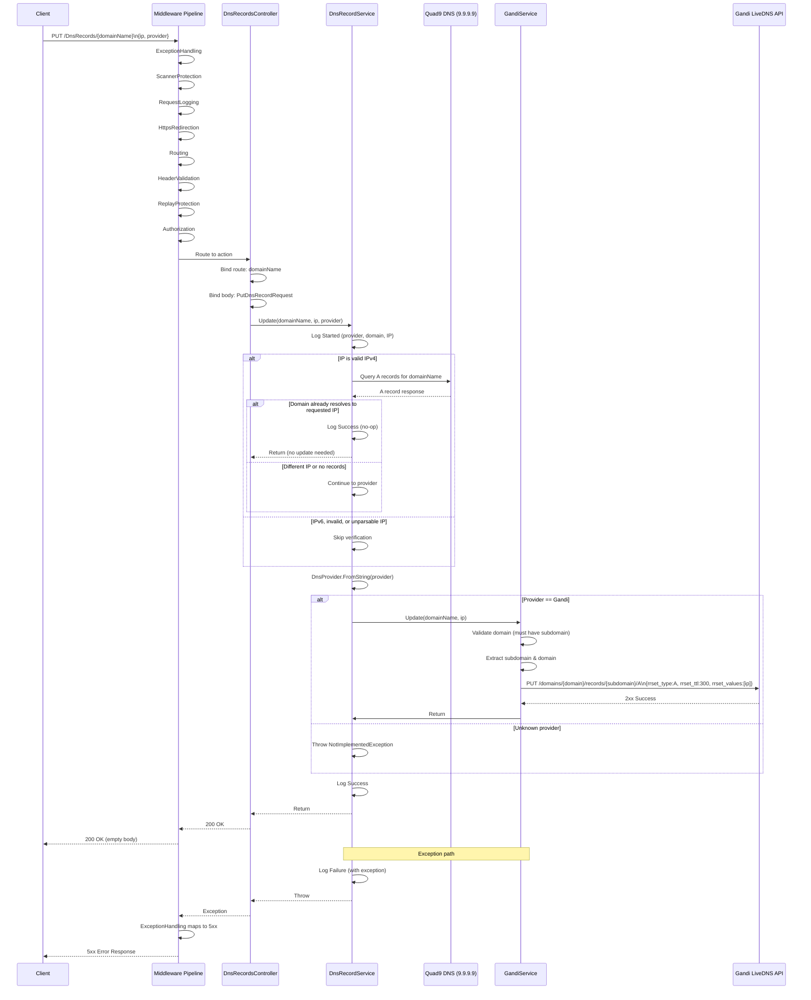

# DNS Record Update Flow

## Overview

This document describes the end-to-end flow for updating a DNS A record, from HTTP request receipt through DNS verification to provider API call. It includes a sequence diagram and detailed step-by-step breakdown.

## Sequence Diagram



## Detailed Flow Steps

### Phase 1: Request Ingress (Middleware Pipeline)

| Step | Middleware | Action | Short-Circuit Condition |
|------|------------|--------|------------------------|
| 1 | ExceptionHandling | Wraps entire pipeline | Never (catches all) |
| 2 | ScannerProtection | Check UA/IP against blocklists | Match → 403 Forbidden |
| 3 | RequestLogging | Log request metadata | Never |
| 4 | HttpsRedirection | Redirect HTTP→HTTPS | HTTP request → 307 |
| 5 | Routing | Match to controller/action | No match → 404 |
| 6 | HeaderValidation | Validate NuciAPI headers | Invalid → 400 |
| 7 | ReplayProtection | Validate HMAC/nonce/timestamp | Invalid → 401 |
| 8 | Authorization | Validate API key | Invalid → 401 |

### Phase 2: Controller Processing

```csharp
[HttpPut("{domainName}")]
public async Task<ActionResult> Update(
    [FromRoute] string domainName,
    [FromBody] PutDnsRecordRequest request)
    => await ProcessRequestAsync(
        request,
        () => service.Update(
            domainName,
            request.IpAddress,
            request.DnsProvider),
        authorisation);
```

**Binding:**
- `domainName` from route parameter (URL-decoded)
- `request.IpAddress` from JSON body property `ip`
- `request.DnsProvider` from JSON body property `provider`

**Authorisation:** `NuciApiAuthorisation.ApiKey(securitySettings.ApiKey)`

### Phase 3: Application Service Orchestration

#### 3.1 Operation Logging (Started)
```csharp
logger.Info(
    MyOperation.UpdateDnsRecord,
    OperationStatus.Started,
    new LogInfo(MyLogInfoKey.Provider, dnsProviderName),
    new LogInfo(MyLogInfoKey.DomainName, domainName),
    new LogInfo(MyLogInfoKey.IpAddress, ipAddress));
```

#### 3.2 DNS Verification (Short-Circuit Optimisation)

**Condition:** Only for valid IPv4 addresses
```csharp
if (IPAddress.TryParse(ipAddress, out IPAddress addr) &&
    addr.AddressFamily == AddressFamily.InterNetwork)
{
    // Query Quad9
}
else
{
    // Skip verification for IPv6, invalid, or unparsable
}
```

**Quad9 Query:**
- **Servers:** 9.9.9.9, 149.112.112.112 (IPv4)
- **Protocol:** UDP (default), TCP fallback
- **Query Type:** A (IPv4 address)
- **Cache:** Disabled (`UseCache = false`)
- **Timeout:** Default DnsClient timeouts

**Response Processing:**
```csharp
bool alreadyResolved = response.Answers
    .ARecords()
    .Any(record => record.Address.Equals(requestedAddress));
```

**Outcomes:**
| DNS Result | Action |
|------------|--------|
| Domain resolves to requested IP | Log Success, return (no-op) |
| Domain resolves to different IP | Continue to provider update |
| No A records (NXDOMAIN, empty) | Continue to provider update |
| DNS error (timeout, SERVFAIL) | Continue to provider update (non-fatal) |

#### 3.3 Provider Selection

```csharp
DnsProvider provider = DnsProvider.FromString(dnsProviderName);

if (provider == DnsProvider.Gandi)
{
    await gandiService.Update(domainName, ipAddress);
}
else
{
    throw new NotImplementedException(
        "The requested DNS provider is not supported.");
}
```

**Provider Resolution:**
| Input | `DnsProvider.FromString()` | Result |
|-------|---------------------------|--------|
| "Gandi" (case-insensitive) | `DnsProvider.Gandi` | Gandi path |
| "gandi" | `DnsProvider.Gandi` | Gandi path |
| "Cloudflare" | `null` | Exception |
| "" or null | `null` | Exception |

#### 3.4 Provider Adapter Call (Gandi)

**GandiService.Update Flow:**
```
1. Validate domainName contains '.'
2. Split at first dot: subdomain, domain
3. Construct URL: https://api.gandi.net/v5/livedns/domains/{domain}/records/{subdomain}/A
4. Create payload: {rrset_type:"A", rrset_ttl:300, rrset_values:[ipAddress]}
5. Create HttpRequestMessage (PUT, JSON, Bearer auth)
6. Send via new HttpClient()
7. EnsureSuccessStatusCode()
8. Log Success
```

#### 3.5 Operation Logging (Success)
```csharp
logger.Info(
    MyOperation.UpdateDnsRecord,
    OperationStatus.Success,
    new LogInfo(MyLogInfoKey.Provider, dnsProviderName),
    new LogInfo(MyLogInfoKey.DomainName, domainName),
    new LogInfo(MyLogInfoKey.IpAddress, ipAddress));
```

### Phase 4: Response Egress

**Success Path:**
- Controller returns `ProcessRequestAsync` result → 200 OK (empty body)
- Middleware pipeline unwinds (logging, etc.)
- Response sent to client

**Exception Path:**
```
Exception thrown in Service/Provider
    ↓
Caught by UseNuciApiExceptionHandling (first middleware)
    ↓
Mapped to standardised error response
    ↓
Logged with full context
    ↓
HTTP error response sent (5xx for unhandled, 4xx for known)
```

## Data Flow Summary

```
HTTP Request
    │
    ├── Route: domainName (string, URL-decoded)
    ├── Header: Authorization: Bearer <api-key>
    ├── Header: X-Nuci-* (protocol headers)
    └── Body: { "ip": "192.0.2.1", "provider": "Gandi" }
        │
        ▼
Controller Binding
    │
    ├── domainName → string
    ├── request.IpAddress → "192.0.2.1"
    └── request.DnsProvider → "Gandi"
        │
        ▼
Service.Update(domainName, "192.0.2.1", "Gandi")
    │
    ├── Log Started
    ├── Parse IP → IPv4? → Quad9 A query
    │       │
    │       ├── Already resolved? → Log Success, RETURN
    │       └── Not resolved → Continue
    │
    ├── DnsProvider.FromString("Gandi") → DnsProvider.Gandi
    │
    ├── GandiService.Update(domainName, "192.0.2.1")
    │       │
    │       ├── Validate "sub.example.com" format
    │       ├── Split → subdomain="sub", domain="example.com"
    │       ├── PUT https://api.gandi.net/v5/livedns/domains/example.com/records/sub/A
    │       │   Body: {rrset_type:"A", rrset_ttl:300, rrset_values:["192.0.2.1"]}
    │       │   Auth: Bearer <gandi-api-key>
    │       ├── 2xx → Log Success, RETURN
    │       └── 4xx/5xx → Throw HttpRequestException
    │
    ├── Log Success
    └── Return
        │
        ▼
HTTP 200 OK (empty)
```

## Error Scenarios

| Scenario | Detection Point | HTTP Response | Logged |
|----------|-----------------|---------------|--------|
| Invalid API key | Authorization middleware | 401 | Yes (middleware) |
| Missing NuciAPI headers | HeaderValidation middleware | 400 | Yes (middleware) |
| Replay attack | ReplayProtection middleware | 401 | Yes (middleware) |
| Scanner detected | ScannerProtection middleware | 403 | Yes (middleware) |
| Invalid JSON body | Model binding | 400 | Yes (middleware) |
| Domain lacks subdomain | GandiService validation | 500* | Yes (service) |
| Gandi API 4xx/5xx | HttpClient.EnsureSuccessStatusCode | 500* | Yes (service) |
| Quad9 timeout | DnsClient exception | N/A (non-fatal) | Yes (service, debug) |
| Unknown provider | DnsProvider selection | 500* | Yes (service) |

* Mapped by ExceptionHandling middleware to standardised error format

## Performance Characteristics

| Operation | Typical Latency | Notes |
|-----------|-----------------|-------|
| Middleware pipeline | < 5ms | Mostly pass-through |
| Controller binding | < 1ms | Minimal work |
| Quad9 DNS query | 20-100ms | Network dependent; UDP |
| Gandi API call | 100-500ms | HTTPS, external API |
| Total (cache miss) | 150-600ms | Dominated by external calls |
| Total (cache hit) | 50-150ms | Short-circuits provider call |

## Concurrency Considerations

- **Static Quad9 client** — Thread-safe, shared across all requests
- **Transient services** — New instance per request, no shared state
- **HttpClient in GandiService** — Created per call, no connection pooling
- **No request-scoped locks** — Fully stateless, horizontally scalable

## Idempotency

The DNS update operation is **idempotent**:
- PUT to Gandi with same values → Returns 2xx (create or update)
- Multiple identical requests → Same end state
- Short-circuit on already-resolved IP → No provider call, still idempotent

## Testing the Flow

### Integration Test Coverage
- `DnsRecordsApiTests.cs` — Full pipeline with mocked service
- `RequestSecurityApiTests.cs` — Auth, replay, scanner, headers
- `ExceptionHandlingApiTests.cs` — Exception mapping

### Unit Test Coverage
- `DnsRecordServiceTests.cs` — Service logic with mocked dependencies
- `GandiServiceTests.cs` — Provider logic with mocked HTTP
- `DnsProviderTests.cs` — Provider model parsing